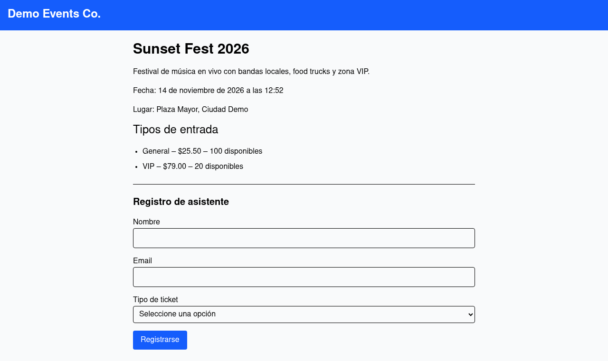
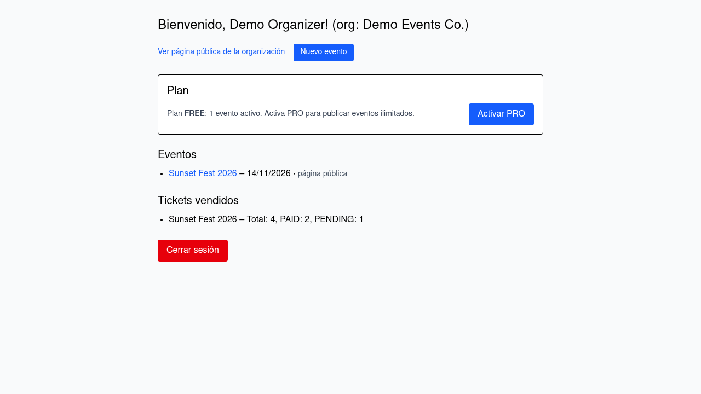
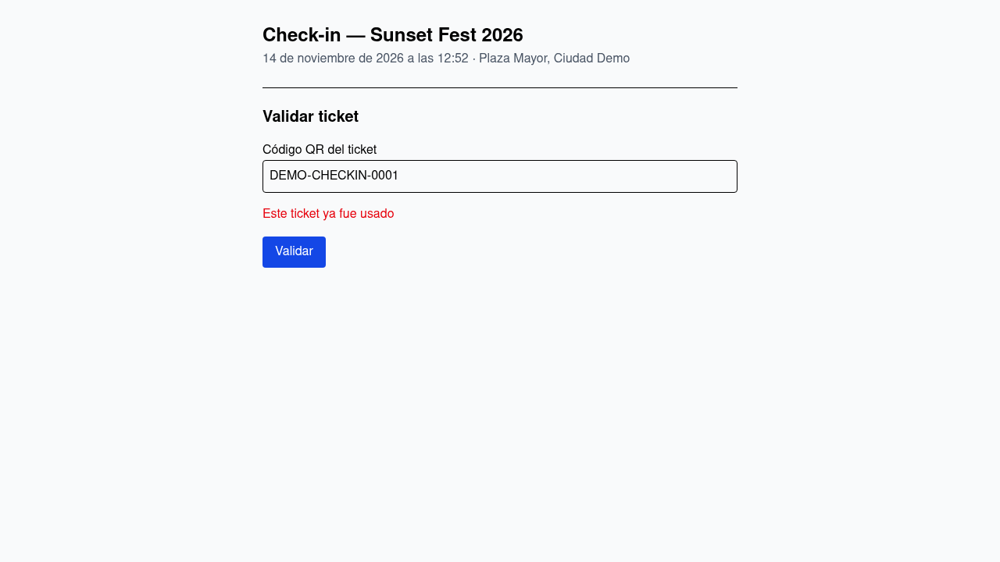

# EventRoll

**Event ticketing and QR check-in for organizers** — a multi-tenant SaaS where organizations publish events, take attendee registrations on public pages, and validate tickets at the door.




## The problem it solves

Small event organizers usually run registration with spreadsheets, DMs and word of mouth: there is no single place where attendees register, stock is tracked, and tickets are validated. EventRoll gives every organization its own public mini-site (`/their-slug`), issues a QR ticket for each registration, keeps a live dashboard of sales, and turns check-in at the door into a two-second scan of the ticket code.

## Features

- **Public registration pages per organization** — ticket types with price and stock, capacity enforcement, atomic stock decrement (no overselling under concurrent registrations).
- **QR tickets** — each attendee receives a ticket with a unique code right after registering.
- **Organizer dashboard** — event list, ticket stats (total / paid / pending) and full event & ticket-type management (create, edit, delete).
- **Check-in** — validate a ticket code at the door; the PAID → USED transition is atomic (double check-in is impossible) and already-used tickets are reported.
- **Monthly PRO subscription** — Stripe Checkout in test mode; the FREE plan keeps 1 active event, PRO is unlimited (entitlements enforced server-side).
- **Multi-tenant by design** — every query and mutation is scoped by `organizationId`; cross-organization access returns 404.
- **Auth** — credentials login with Auth.js v5, JWT sessions, protected routes via Proxy (Next 16's middleware).
- **Quality gates** — Zod validation, Vitest unit/integration suites, Playwright end-to-end tests with screenshots, GitHub Actions CI.

| Dashboard | Check-in |
| --- | --- |
|  |  |

## Tech stack

| Layer | Choice |
| --- | --- |
| Framework | Next.js 16 (App Router, Server Actions, Proxy) |
| Language | TypeScript (strict) |
| Database | PostgreSQL + Prisma |
| Auth | Auth.js (NextAuth v5, credentials + JWT) |
| Payments | Stripe Billing (Checkout + webhooks, test mode) |
| Styling | Tailwind CSS v4 |
| Testing | Vitest, Playwright |
| Tooling | pnpm, GitHub Actions |

## Architecture

```
app/
├── (auth)/               login · register
├── (public)/[orgSlug]/   org landing · events · event detail (+ registration) · ticket
├── dashboard/            organizer area (stats, event CRUD, billing plan)
├── checkin/[orgSlug]/…   door check-in
└── api/stripe/webhook    subscription sync
actions/                  server actions (auth, register, events, ticket-types, checkin, billing)
lib/                      prisma client, billing/entitlements, tenant queries, DTOs, validations
proxy.ts                  route protection (session required for /dashboard and /checkin)
```

## Getting started

```bash
# 1. Start PostgreSQL
docker compose up -d

# 2. Install dependencies
pnpm install

# 3. Configure environment
cp .env.example .env
# generate the AUTH_SECRET value with:
openssl rand -base64 32

# 4. Apply migrations and load demo data
pnpm migrate
pnpm seed

# 5. Run
pnpm dev
```

Open <http://localhost:3000/demo>.

### Demo credentials

| What | Value |
| --- | --- |
| Organizer login | `demo@eventroll.dev` / `eventroll-demo` |
| Check-in code (valid) | `DEMO-CHECKIN-0001` |
| Check-in code (already used) | `DEMO-CHECKIN-0002` |

## Stripe (test mode)

1. Create a free Stripe account and stay in **test mode**.
2. Products → create a product with a monthly recurring price and copy its **price id**.
3. Fill `STRIPE_SECRET_KEY`, `STRIPE_PRICE_PRO` and `STRIPE_WEBHOOK_SECRET` in `.env`.
4. Forward webhooks locally:

   ```bash
   stripe listen --forward-to localhost:3000/api/stripe/webhook
   ```

5. In the dashboard, click **Activar PRO** and pay with the test card `4242 4242 4242 4242`.

Without Stripe keys the app still works end to end; only the PRO upgrade reports that Stripe is not configured.

## Scripts

| Script | Purpose |
| --- | --- |
| `pnpm dev` | Development server |
| `pnpm build` / `pnpm start` | Production build / server |
| `pnpm migrate` | Apply Prisma migrations |
| `pnpm seed` | Recreate deterministic demo data |
| `pnpm typecheck` | TypeScript, no emit |
| `pnpm lint` | ESLint |
| `pnpm test` | Vitest unit/integration tests |
| `pnpm test:e2e` | Playwright end-to-end tests (seeds the DB and boots a dev server) |

## Testing

- **Unit/integration (Vitest)** cover the domain rules: price serialization across the server/client boundary, atomic stock and capacity enforcement, check-in transitions, subscription entitlements and Stripe webhook handling.
- **End-to-end (Playwright)** cover the real user journeys: visitor registration → QR ticket, organizer login → dashboard → check-in (including double-scan rejection), and the FREE plan blocking a second active event. Screenshots land in `docs/screenshots/`.

## Deploy for free

The whole stack fits in free tiers (no credit card, no expiry) — good enough for a portfolio demo:

1. **Database — [Neon](https://neon.com) Free plan** (100 CU-hours/month, 1 GB storage, scales to zero when idle): create a project and copy the *pooled* connection string. Apply the schema and demo data from your machine:

   ```bash
   DATABASE_URL="<neon-connection-string>" pnpm exec prisma migrate deploy
   DATABASE_URL="<neon-connection-string>" pnpm seed
   ```

2. **Hosting — [Vercel](https://vercel.com) Hobby plan** ($0, personal/non-commercial): import this repository and set the environment variables (`DATABASE_URL`, `AUTH_SECRET`, `NEXT_PUBLIC_APP_URL` and, optionally, the Stripe ones). Deploy.

3. *(Optional)* **Stripe** test mode is also free: add the test keys and point the webhook at `https://your-app.vercel.app/api/stripe/webhook`.

## Roadmap

- Camera scanner for check-in.
- Card payments for attendee tickets (paid tickets currently stay PENDING).
- Email delivery of tickets.
- Per-event customization (branding, custom fields).

## License

[MIT](LICENSE)
